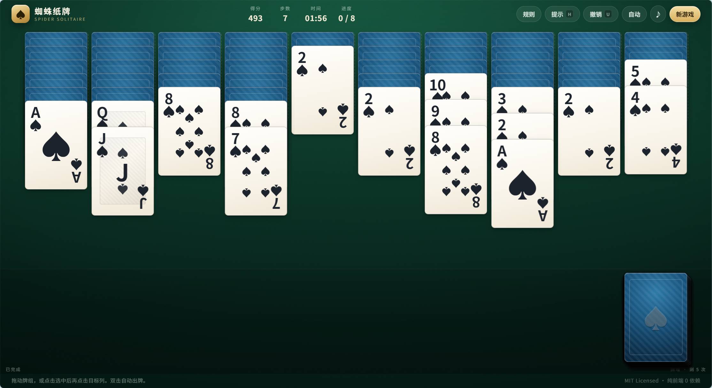

# 蜘蛛纸牌 · Spider Solitaire

[](LICENSE)
[](package.json)
[](js/)
[](https://549763551.github.io/spider-solitaire/)

**纯前端、零运行时依赖、可离线游玩的蜘蛛纸牌。** 单文件页面启动即玩，支持单 / 双 / 四花色三种难度、拖拽与点击两套操作、无限撤销、智能提示、自动合并、自动存档与响应式布局。

> 🎮 在线试玩：<https://549763551.github.io/spider-solitaire/>



---

## 特性

| | |
| --- | --- |
| 🃏 **三种难度** | 单花色（轻松）／双花色（进阶）／四花色（困难），牌数与发牌规则完全按经典蜘蛛纸牌 |
| 🖱️ **两种操作** | 鼠标 / 触屏拖拽整组牌，或「点选牌组 → 点目标列」两步操作；双击自动出牌 |
| ↩️ **无限撤销** | 每一步都可回退（含发牌），快照式存档，撤销不丢牌 |
| 💡 **智能提示** | 按「同花色接龙 &gt; 翻开暗牌 &gt; 收牌 &gt; 空列」加权评分，高亮最优一步 |
| 🤖 **自动合并** | 一键把所有同花色可接的牌自动归位，单调推进、不会来回折腾 |
| 💾 **自动存档** | 关掉浏览器再打开可继续上一局（`localStorage`） |
| 🎬 **动画细节** | 3D 翻牌、牌组跟手拖拽、发牌与收牌飞行动画、通关彩带 |
| 📱 **响应式** | 桌面 10 列铺满，手机竖屏自动压缩牌面与行距 |
| 🔊 **音效** | WebAudio 合成音，无音频文件；可一键静音 |
| 🧩 **零依赖** | 运行时 0 依赖、无构建步骤，`index.html` 双击即可运行 |

## 快速开始

直接双击 `index.html` 就能玩（脚本均为普通 `<script>`，兼容 `file://`）。

想用本地服务器：

```bash
# 方式一：任意静态服务器
python -m http.server 8080

# 方式二：仓库自带零依赖服务器
npm run serve
```

然后打开 <http://localhost:8080/>。

## 操作

| 操作 | 说明 |
| --- | --- |
| 拖拽 | 按住一组**同花色连续递减**的牌拖到目标列 |
| 点选 | 点牌组选中 → 点目标牌 / 目标空列完成移动 |
| 双击 | 自动把该组牌移到最合适的列 |
| 点牌堆 | 给 10 列各发一张明牌（有空列时无法发牌） |
| 快捷键 | `U` / `Ctrl+Z` 撤销 · `H` 提示 · `A` 自动合并 · `N` 新游戏 · `空格` 发牌 · `Esc` 取消选择 |

## 规则

1. 使用两副牌共 **104 张**，摆成 10 列：前 4 列各 6 张、后 6 列各 5 张，每列仅最上面一张明牌。
2. 可以把**同花色且点数连续递减**的一段牌整体搬走；落点必须是比这段牌首张**大 1** 的牌，或一个空列。
3. 凑齐 **K→A 同花色 13 张** 会自动收走，计入「已完成」；收满 8 组即通关。
4. 牌堆共 5 次发牌，每次给每列各发一张。**存在空列时不能发牌**。
5. 计分：初始 **500** 分，每移动一次 **-1** 分，收走一组 **+100** 分。

## 项目结构

```
spider-solitaire/
├── index.html              # 页面结构（工具栏 / 牌桌 / 弹窗）
├── css/
│   └── style.css           # 全部样式：牌面、动画、响应式
├── js/
│   ├── game.js             # 规则引擎：发牌、合法走法、收牌、计分、序列化
│   ├── app.js              # 渲染、几何布局、指针交互、存档、计时
│   └── sound.js            # WebAudio 合成音效
├── assets/
│   └── favicon.svg
├── tests/
│   ├── engine.test.js      # 规则引擎测试（Node，无依赖，68 项断言）
│   └── ui.test.js          # jsdom 交互冒烟测试（23 项断言）
├── scripts/
│   └── serve.js            # 本地静态服务器
└── .github/workflows/
    └── deploy.yml          # 推送 main 自动发布到 GitHub Pages
```

## 实现要点

- **布局即动画**：所有牌都是 `.card-layer` 里的绝对定位元素，`measure()` 按视口算出牌宽、列间距、明牌/暗牌堆叠步长（超长列自动压缩），渲染时只改 `transform: translate3d(...)` 与 `z-index`。CSS `transition` 负责所有位移，发牌、收牌、撤销回弹都是免费的动画。
- **规则与视图分离**：`js/game.js` 不接触 DOM，`capture()` / `undo()` 用快照栈实现撤销，`serialize()` / `deserialize()` 负责存档，因此同一套规则能直接在 Node 里跑测试。
- **拖拽**：`pointerdown` 记录起点，位移超过阈值才进入拖拽；拖拽期间直接改写 `transform` 让牌跟手，松手时用列几何命中测试，合法则落子，否则渲染一次即可回弹。
- **提示评分**：对每个合法走法按「接同花色 +45 / 翻出暗牌 +60 / 空出列 +25 / 凑成整组 +500」加权，取最高分并高亮来源与目标。
- **自动合并的终止性**：只执行「落到同花色上」的合并，且要求同花色相邻对数严格增加；因此循环必然收敛，不会出现来回搬牌的死循环。
- **存档**：`localStorage` 键 `spider-solitaire/v1`，保存牌面、牌堆、已完成牌组与用时；页面隐藏 / 关闭时立即落盘。

## 测试

```bash
npm install     # 仅安装测试用的 jsdom
npm test        # 规则引擎 68 项 + jsdom 交互 23 项
```

只需要规则引擎时可以直接 `node tests/engine.test.js`，无需安装任何依赖。

## 部署到 GitHub Pages

仓库已内置 [`.github/workflows/deploy.yml`](.github/workflows/deploy.yml)：

1. `Settings → Pages → Source` 选择 **GitHub Actions**；
2. 推送到 `main` 后自动构建并发布静态站点；
3. 站点地址：`https://<你的用户名>.github.io/spider-solitaire/`。

## 许可

[MIT](LICENSE) © 2026 549763551

---

## English

A polished Spider Solitaire that runs entirely in the browser — **no build step, no runtime dependencies**.

**Play online:** <https://549763551.github.io/spider-solitaire/>

### Features

- 1-suit / 2-suit / 4-suit difficulties with the classic 104-card deal.
- Drag a same-suit descending run, or tap a run and then a destination; double-click to auto-play.
- Unlimited undo (snapshots), scored hints, safe auto-merge, timer and scoring.
- Auto-save and resume through `localStorage`; fully responsive; WebAudio sound effects with a mute toggle.
- 3D card flips and transform-driven animation for dealing, collecting and undoing.

### Run

```bash
git clone https://github.com/549763551/spider-solitaire.git
cd spider-solitaire
# open index.html directly, or:
python -m http.server 8080    # then visit http://localhost:8080
```

### Rules

Deal 104 cards into 10 columns (4 × 6, 6 × 5). Only same-suit descending runs may be moved, and only onto a card one rank higher or onto an empty column. A complete K→A same-suit run is collected automatically; collect all 8 to win. Score starts at 500, −1 per move, +100 per collected run. The stock deals one card to every column, five times in total, and refuses to deal while a column is empty.

### Test

```bash
npm install
npm test
```

### License

MIT — see [LICENSE](LICENSE).
